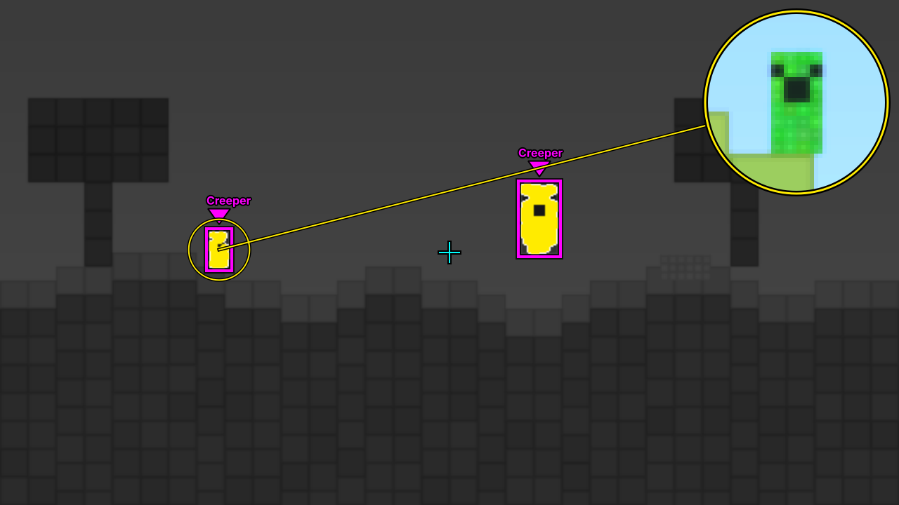

# MineColorTrack

A low-vision helper for games streamed with PS Remote Play on Windows, built with Minecraft in mind.
It watches the Remote Play picture, finds things of a chosen colour (for example creepers) and makes
them easier to see. You can use outlines, a high-contrast view, a magnifier lens, or any mix of the three.

It only draws on screen. It never sends controller, mouse or keyboard input to the game.


## Download and install

1. Open the **Releases** page of this repository (right-hand side on GitHub, or `/releases`).
2. Under **Assets** of the newest release, download `MineColorTrack-Setup-<version>.exe`.
3. Run it. It installs for your Windows user only (no administrator password), adds a
   **desktop shortcut** and a Start menu entry. Uninstall from Windows Settings > Apps.

Windows SmartScreen may say "Windows protected your PC" because the installer is not code-signed.
Click **More info**, then **Run anyway**.

Requirements: 64-bit Windows 10 version 2004 or newer, or Windows 11. Nothing else to install.

## Quick start for Minecraft

1. Open PS Remote Play and start Minecraft. Keep the Remote Play window visible (not minimised).
2. Open MineColorTrack from the desktop shortcut, pick a profile such as "Minecraft: creepers"
   and press **Start**.
3. Go to **Targets**, press **Pick colour from the game...** and click on a creeper.
   The live preview shows in white what will be highlighted.
4. If grass or leaves light up too, raise **Brightness min** and **Saturation min** a little,
   lower **Hue tolerance**, or raise **Minimum size**. If the creeper is only partly white, do the opposite.
5. Click back on the Remote Play window so it gets your controller input again.

Settings save automatically. Creepers, grass and leaves are similar greens in Minecraft, so step 4
matters. Night, caves and rain change colours, so a separate profile for each (Home > Manage profiles >
Duplicate) works better than one compromise.




## What you can set

| Page | Options |
|---|---|
| Home | Start/stop, profile, quick switches for each assist mode and each target, overlay or mirror window, crosshair |
| Targets | Any number of colours per profile with name, hue tolerance, saturation and brightness range, size limits and outline colour; on-screen colour picker that suggests tolerances; live preview |
| Outline | Box, corner brackets or ellipse; thickness; spacing; black backing line; per-target or single colour; arrow or dot marker; names; blinking; dashed "last seen" outline |
| High contrast | Dim the rest (0 to 100 %), turn it grey, paint targets a solid colour or boost their real colours, thicken them, white edge |
| Magnifier | Zoom 1.5x to 10x, size, circle or square, corner or next-to-target placement, which target to follow, extra contrast, sharp pixels, link line |
| Capture | Follow the PS Remote Play window, a whole monitor, or a dragged region; frames per second; processing resolution |
| Tracking | Smoothing, how long a lost target stays marked, joining pieces into one target, speck filter |
| Hotkeys | Global hotkeys that work while the game has focus (defaults: Ctrl+Alt+A start/stop, Ctrl+Alt+P next profile, Ctrl+Alt+O outline, Ctrl+Alt+C high contrast, Ctrl+Alt+M magnifier) |
| Settings | Dark, light or high-contrast (black and yellow) theme; text size; start on launch; keep running in the system tray |

Five Minecraft presets are included (creepers, zombies, night eyes, common hostiles, strong low-vision).
Their colours are starting points only; re-pick them in your own game.
Settings file: `%APPDATA%\MineColorTrack\config.json`. Crash details, if any: `error.log` in the same folder.

## Overlay vs. mirror window

- **Overlay** sits exactly on top of the Remote Play picture, follows the window and is click-through.
  Windows has to hide it from screen capture so the program never detects its own drawings
  (Windows 10 version 2004 or newer). MineColorTrack tests this when it starts and switches to the
  mirror window if it fails.
- **Mirror** shows the processed picture in its own window, for example on a second monitor.
  Keep Remote Play visible somewhere (it can be small, but not minimised or covered).

## Limits

- Colour matching only. It cannot tell a creeper from green blocks of the same shade; tuning and
  size limits are how you separate them.
- Stream compression and motion blur make outlines shimmer a little. Raise **Smoothing** if it bothers you.
- If Remote Play runs in exclusive full screen, overlays may not show on top. Use windowed or
  maximised Remote Play, or the mirror window.

## For developers

Run from source (Python 3.10+):

```
py -3 -m pip install -r requirements.txt
py -3 run.py
py -3 -m pip install pytest pillow && py -3 -m pytest tests
```

Releases are built by `.github/workflows/release.yml` on a Windows runner when a `v*` tag is pushed:
unit tests, PyInstaller (`packaging/MineColorTrack.spec`), a `--selftest` of the built app, the Inno Setup
installer (`packaging/MineColorTrack.iss`), a silent test install that checks the desktop shortcut,
and finally the GitHub release.

Code map: `colorassist/vision.py` detection and effects (numpy/OpenCV, no GUI), `engine.py` capture
thread, `view.py` overlay/mirror drawing, `panel.py` and `ui.py` control panel and themes,
`winplat.py` Windows API calls, `app.py` wiring, tray, self-test.
